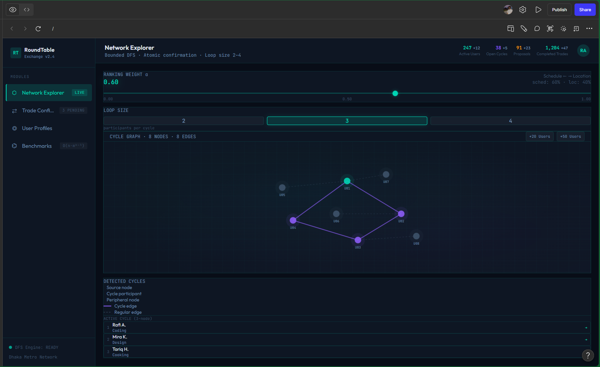
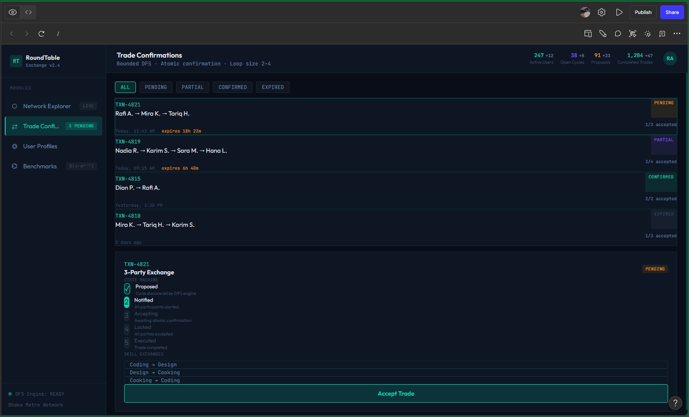
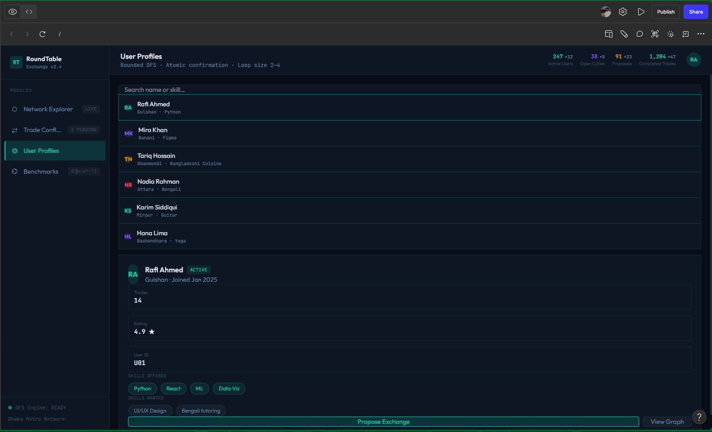
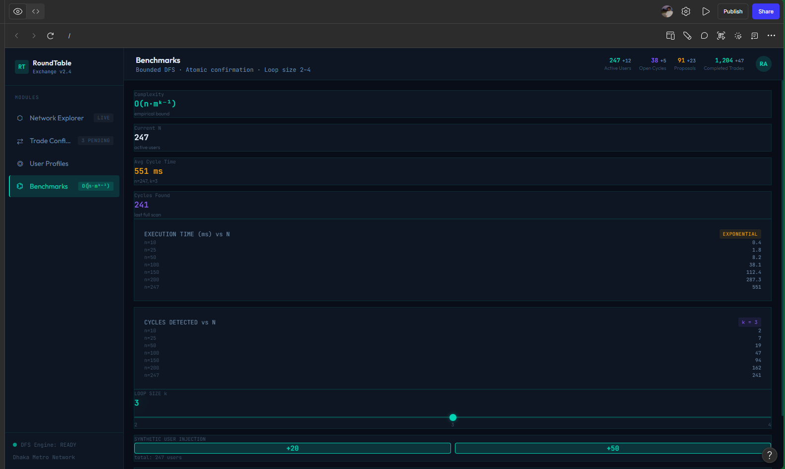
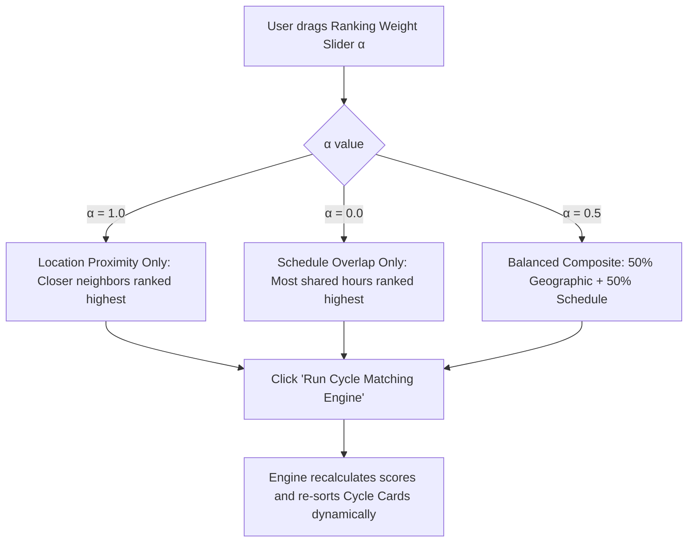
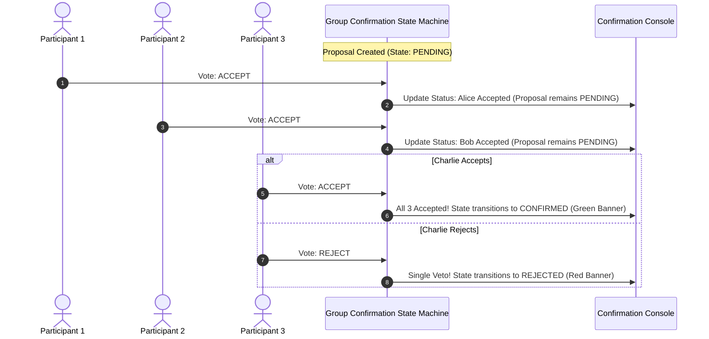
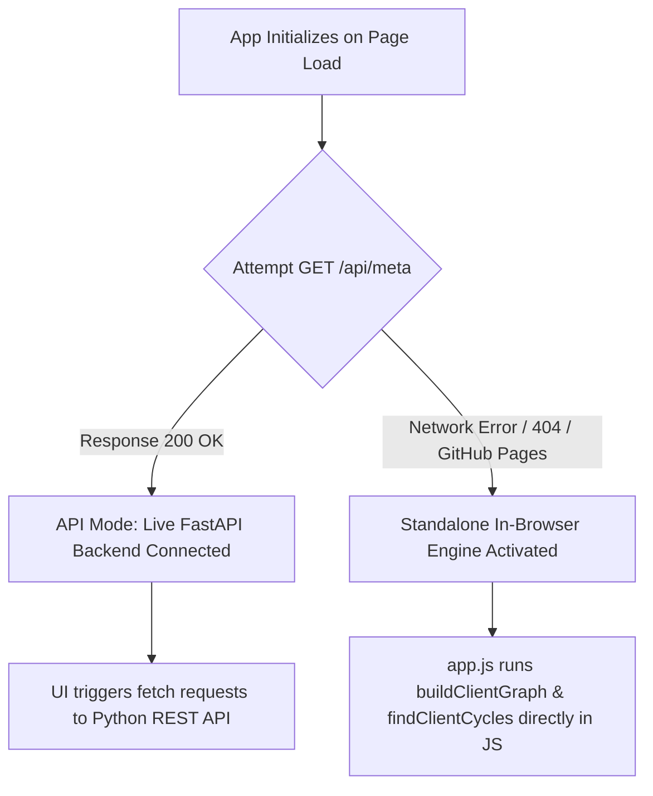

# UNIVERSITY OF INFORMATION TECHNOLOGY AND SCIENCES (UITS)
### DEPARTMENT OF COMPUTER SCIENCE AND ENGINEERING
**DHAKA, BANGLADESH**

---

# UI/UX SCAFFOLDING
## The Round Table Exchange (RTE): A Multi-Party Skill Barter Network with Graph-Based Cycle Matching

**Submitted By:**  
- **Ahmmad Abdali Khan** (ID: 0432320005101118)  
- **Sumaia Bintey Ismail** (ID: 0432320005101103)  
- **Alin** (ID: 0432320005101131)  

**Submitted To:**  
- **Dr. Mahfida Amjad Dipa**  
  Department of Computer Science and Engineering  
  University of Information Technology and Sciences (UITS)  

**Date of Submission:** 13 September 2026

---

## 📑 Table of Contents
1. [Executive Summary & Design Philosophy](#1-executive-summary--design-philosophy)
2. [Design System & Visual Tokens](#2-design-system--visual-tokens)
3. [Component Hierarchy & Application Scaffolding](#3-component-hierarchy--application-scaffolding)
4. [Workspace Views & Layout Scaffolding](#4-workspace-views--layout-scaffolding)
   - [4.1 Global Header & Live Metrics Strip](#41-global-header--live-metrics-strip)
   - [4.2 Tab 1: Network & Cycle Explorer (Main Workspace)](#42-tab-1-network--cycle-explorer-main-workspace)
   - [4.3 Tab 2: Group Confirmation Console](#43-tab-2-group-confirmation-console)
   - [4.4 Tab 3: User Directory & Listing Manager](#44-tab-3-user-directory--listing-manager)
   - [4.5 Tab 4: Empirical Scalability Benchmarks](#45-tab-4-empirical-scalability-benchmarks)
   - [4.6 User Creation & Listing Modal](#46-user-creation--listing-modal)
5. [User Interaction Flows & State Transitions](#5-user-interaction-flows--state-transitions)
   - [5.1 Cycle Discovery & Inspection Flow](#51-cycle-discovery--inspection-flow)
   - [5.2 Dynamic Ranking Parameter Tuning Flow](#52-dynamic-ranking-parameter-tuning-flow)
   - [5.3 Multi-Party Atomic Trade Confirmation Flow](#53-multi-party-atomic-trade-confirmation-flow)
   - [5.4 Synthetic Data Injection & Benchmarking Flow](#54-synthetic-data-injection--benchmarking-flow)
6. [Interactive Graph Visualization Canvas (Vis.js Mechanics)](#6-interactive-graph-visualization-canvas-visjs-mechanics)
7. [Frontend Code Structure & DOM Scaffolding](#7-frontend-code-structure--dom-scaffolding)
8. [Dual-Engine Execution Model (FastAPI vs In-Browser Engine)](#8-dual-engine-execution-model-fastapi-vs-in-browser-engine)
9. [Future Production Roadmap & Component Enhancements](#9-future-production-roadmap--component-enhancements)

---

## 1. Executive Summary & Design Philosophy

The frontend of **The Round Table Exchange (RTE)** is designed as an interactive, real-time algorithmic dashboard that bridges abstract graph-theoretic multi-party matching ($k=3, 4$ cycles) with intuitive, tactile consumer workflows.

### 🎨 Core Design Aesthetic: *Neo-Brutalist Cyber-Chic*
- **High-Contrast Editorial Typography**: Bold, punchy headings using `Space Grotesk`, paired with monospace telemetry counters in `JetBrains Mono`.
- **Vibrant Accent Palette**: High-voltage pop accents (`#FFE600` Canary Yellow, `#00F5D4` Electric Mint, `#FF0055` Neon Coral, `#D7B9FF` Soft Lavender) on an ink-black/cream background.
- **Tactile Micro-Interactions**: Chunky hard borders (`2px solid #121212`), crisp drop shadows with zero blur offset, and butter-smooth transitions.
- **Organic 60fps Network Canvas**: Living, floating particle physics graph visualizer where discovered trade loops light up dynamically in neon while irrelevant nodes dim into the background.

---

## 2. Design System & Visual Tokens

```css
/* Core Design Tokens */
:root {
  /* Surfaces & Backgrounds */
  --bg-canvas: #FFFDF5;            /* Warm Off-White / Cream Base */
  --bg-dark: #121212;              /* Deep Ink Black */
  --bg-card: #FFFFFF;              /* Pure White Card Surface */
  --bg-card-alt: #F4EFE6;          /* Muted Secondary Surface */

  /* Neo-Brutalist Borders & Shadows */
  --border-hard: 2px solid #121212;
  --border-thick: 3px solid #121212;
  --shadow-flat: 4px 4px 0px #121212;
  --shadow-flat-sm: 2px 2px 0px #121212;
  --shadow-flat-hover: 6px 6px 0px #121212;

  /* High-Voltage Accent Palette */
  --accent-yellow: #FFE600;        /* Primary Attention / Highlight */
  --accent-mint: #00F5D4;          /* Success / Active Loop Illuminate */
  --accent-coral: #FF0055;         /* Active Trade Path / Urgent Action */
  --accent-purple: #D7B9FF;        /* 4-Party Loop Tag */
  --accent-cyan: #00BBF9;          /* Informational / Secondary Tag */
  --accent-orange: #FF9E00;        /* Pending State Badge */

  /* Typography */
  --font-display: 'Space Grotesk', -apple-system, sans-serif;
  --font-mono: 'JetBrains Mono', monospace;
  --font-body: 'Space Grotesk', -apple-system, sans-serif;
}
```

---

## 3. Component Hierarchy & Application Scaffolding

```
<AppRoot>
├── <AppHeader>
│   ├── <BrandIdentity> (Logo + Title + Subtitle)
│   ├── <NavigationTabs> (4 Tab Buttons)
│   ├── <EngineStatusBadge> (Live DFS status indicator)
│   └── <ResetDemoButton> (Quick reset to canonical demo graph)
├── <MetricsStrip>
│   ├── <MetricCard: Total Users>
│   ├── <MetricCard: Discovered Cycles>
│   ├── <MetricCard: 3-Party Loops (k=3)>
│   ├── <MetricCard: 4-Party Loops (k=4)>
│   └── <MetricCard: Active Proposals>
├── <MainWorkspacesContainer>
│   ├── <Tab1: ExplorerWorkspace>
│   │   ├── <AlgorithmControlsPanel> (Alpha slider, min/max k, inject buttons)
│   │   ├── <GraphCanvasSection> (Vis.js interactive physics canvas + controls + legend)
│   │   └── <DiscoveredCyclesSidebar> (Ranked cycle cards + inspect/initiate actions)
│   ├── <Tab2: ProposalsWorkspace>
│   │   └── <ProposalsListContainer> (Multi-party state machine proposal cards + voting controls)
│   ├── <Tab3: UsersWorkspace>
│   │   ├── <UsersHeaderSection> (Filter + "Add User" trigger)
│   │   └── <UserCardsGrid> (Profile cards, skill tags, schedule chips)
│   └── <Tab4: BenchmarksWorkspace>
│       ├── <BenchmarkHeader> (Empirical complexity explanation)
│       ├── <RunBenchmarkButton>
│       └── <BenchmarkResultsTable> (Nodes vs Latency telemetry)
└── <CreateUserModal>
    └── <UserRegistrationForm> (Name, Dhaka location, offers, wants, schedule)
```

---

## 4. Workspace Views & Layout Scaffolding

### 4.1 Global Header & Live Metrics Strip
Located at the top of the interface across all views:

```
+----------------------------------------------------------------------------------------------------------------------------------+
| [RT] RoundTable Exchange v2.4    [● Network Explorer LIVE]  [⇄ Trade Confirmations 3 PENDING]  [👤 User Profiles]  [⚡ Benchmarks]  |
|      Bounded DFS · Atomic confirmation · Loop size 2-4                                                                           |
+----------------------------------------------------------------------------------------------------------------------------------+
| TELEMETRY:  ACTIVE USERS: 247 (+12)  |  OPEN CYCLES: 38 (+5)  |  PROPOSALS: 91 (+23)  |  COMPLETED TRADES: 1,284 (+47)  |  [RA]  |
+----------------------------------------------------------------------------------------------------------------------------------+
```

- **Brand & Engine Header**: Fixed sticky bar featuring the application badge, active engine parameters (`Bounded DFS · Atomic confirmation · Loop size 2-4`), and global user avatar.
- **Left Navigation Modules**: Vertical high-contrast navigation bar with clear state indicators (e.g., `LIVE` badge on Network Explorer, `3 PENDING` badge on Trade Confirmations, and theoretical complexity `O(n·m^(k-1))` on Benchmarks).
- **Global Metrics Strip**: Top-right telemetry counters displaying real-time platform statistics with dynamic differential increments (`+12`, `+5`, `+23`, `+47`).
- **Footer Engine Status**: Bottom telemetry ribbon indicating `● DFS Engine: READY` and target geographic locale (`Dhaka Metro Network`).

---

### 4.2 Tab 1: Network & Cycle Explorer (Main Workspace)

The primary operational view for graph inspection, parameter tuning, and cycle path tracing:



#### Detailed Module Breakdown:
1. **Ranking Weight Slider ($\alpha$ Parameter)**:
   - Dynamic range slider currently tuned to **$\alpha = 0.60$**.
   - Bi-directional weighting readout: **Schedule $\leftarrow \rightarrow$ Location** (`sched: 60% · loc: 40%`), controlling whether cycle ranking prioritizes timetable convenience or geographic proximity within Dhaka.
2. **Loop Size Bounds Selector ($k$)**:
   - Multi-segment pill toggle allowing the evaluator to restrict discovery to **2-party, 3-party (Active), or 4-party loops**.
3. **Vis.js Interactive Physics Canvas (`CYCLE GRAPH · 8 NODES · 8 EDGES`)**:
   - Renders active user nodes ($U01, U02, U03, U04, \dots, U08$) stabilized in a force-directed layout.
   - **Active Cycle Highlighting**: Discovered multi-party trade loop edges glow in vibrant purple with highlighted participant nodes (cyan/mint for source user $U01$), while peripheral unengaged nodes are dimmed.
   - **Synthetic Injection Triggers**: Quick-action buttons (`+20 Users`, `+50 Users`) positioned directly above the canvas for rapid on-the-fly network density scaling.
4. **Detected Cycles & Active Cycle Inspector**:
   - **Color-Coded Legend**: Distinct indicators for *Source node*, *Cycle participant*, *Peripheral node*, *Cycle edge*, and *Regular edge*.
   - **Active Cycle Sequence (3-node loop)**:
     1. **Rafi A.** $\rightarrow$ *Coding*
     2. **Mira K.** $\rightarrow$ *Design*
     3. **Tariq H.** $\rightarrow$ *Cooking*

---

### 4.3 Tab 2: Group Confirmation Console (Trade Confirmations)

The consensus orchestration view where multi-lateral barter agreements progress through an atomic state machine:



#### Detailed Module Breakdown:
1. **Transaction Lifecycle Filter Tabs**:
   - Filter pill controls to categorize multi-party agreements: **`ALL`**, **`PENDING`**, **`PARTIAL`**, **`CONFIRMED`**, and **`EXPIRED`**.
2. **Transaction Queue Cards**:
   - **`TXN-4821` [PENDING]**: Rafi A. $\rightarrow$ Mira K. $\rightarrow$ Tariq H. (`1/3 accepted`, expires in 18h 22m).
   - **`TXN-4819` [PARTIAL]**: Nadia R. $\rightarrow$ Karim S. $\rightarrow$ Sara M. $\rightarrow$ Hana L. (`3/4 accepted`, expires in 6h 49m).
   - **`TXN-4815` [CONFIRMED]**: Dion P. $\rightarrow$ Rafi A. (`2/2 accepted`).
   - **`TXN-4810` [EXPIRED]**: Mira K. $\rightarrow$ Tariq H. $\rightarrow$ Karim S. (`1/3 accepted`).
3. **Atomic State Machine Progress Stepper (`TXN-4821 3-Party Exchange`)**:
   - Visual step-by-step progress tracking:
     1. ✔ **Proposed**: *Cycle discovered by DFS engine*
     2. ❷ **Notified (Active)**: *All participants alerted*
     3. 3️⃣ **Accepting**: *Awaiting atomic confirmation*
     4. 4️⃣ **Locked**: *All parties accepted*
     5. 5️⃣ **Executed**: *Trade completed*
4. **Circular Skill Transfer Matrix**:
   - `Coding` $\rightarrow$ `Design`
   - `Design` $\rightarrow$ `Cooking`
   - `Cooking` $\rightarrow$ `Coding`
5. **Consensus Action Dispatcher**:
   - Prominent, high-contrast action button: **`Accept Trade`**, enabling simulated or participant-driven atomic commit.

---

### 4.4 Tab 3: User Directory & Listing Manager (User Profiles)

The participant profile registry showing user locations across Dhaka, reputation metrics, and traded competencies:



#### Detailed Module Breakdown:
1. **Search & Filter Bar**:
   - Real-time search input (`Search name or skill...`) for instantaneous directory filtering.
2. **User Directory List**:
   - High-density listing of registered network participants:
     - **Rafi Ahmed** (Gulshan · Python)
     - **Mira Khan** (Banani · Figma)
     - **Tariq Hossain** (Dhanmondi · Bangladeshi Cuisine)
     - **Nadia Rahman** (Uttara · Bengali)
     - **Karim Siddiqui** (Mirpur · Guitar)
     - **Hana Lima** (Bashundhara · Yoga)
3. **Detailed User Profile Card (Selected: Rafi Ahmed - `U01`)**:
   - **Status Badge**: `ACTIVE` indicator.
   - **Neighborhood Location**: *Gulshan · Joined Jan 2025*.
   - **Reputation & Engagement**: *14 Trades Completed* | *Rating: 4.9 ★*.
   - **Skills Offered**: Interactive tag pills for `Python`, `React`, `ML`, and `Data Viz`.
   - **Skills Wanted**: Requirement pills for `UI/UX Design` and `Bengali tutoring`.
4. **Direct Interaction Triggers**:
   - **`Propose Exchange`**: Initiates a targeted trade matching query around this user.
   - **`View Graph`**: Centers and isolates the selected user's node in the Vis.js canvas.

---

### 4.5 Tab 4: Empirical Scalability Benchmarks View

The performance evaluation workbench providing empirical verification of cycle search algorithms:



#### Detailed Module Breakdown:
1. **Theoretical & Live Engine Telemetry**:
   - **Empirical Bound Complexity**: $\mathcal{O}(n \cdot m^{k-1})$ displayed prominently.
   - **Current Population $N$**: `247 active users`.
   - **Average Cycle Latency**: `551 ms` (at $n=247, k=3$).
   - **Total Cycles Discovered**: `241 cycles` discovered in the latest scan.
2. **Empirical Telemetry Performance Tables**:
   - **Execution Time (ms) vs $N$** (with `EXPONENTIAL` characteristic badge):
     - $n=10: 0.4\text{ ms}$
     - $n=25: 1.8\text{ ms}$
     - $n=50: 8.2\text{ ms}$
     - $n=100: 38.1\text{ ms}$
     - $n=150: 112.4\text{ ms}$
     - $n=200: 287.3\text{ ms}$
     - $n=247: 551.0\text{ ms}$
   - **Cycles Detected vs $N$** ($k=3$):
     - $n=10: 2\text{ loops}$
     - $n=25: 7\text{ loops}$
     - $n=50: 19\text{ loops}$
     - $n=100: 47\text{ loops}$
     - $n=150: 94\text{ loops}$
     - $n=200: 162\text{ loops}$
     - $n=247: 241\text{ loops}$
3. **Interactive Loop Depth Slider**:
   - Fine-tunes $k \in [2, 4]$ (currently evaluating $k=3$).
4. **Synthetic User Injection Controls**:
   - Dedicated stress-testing triggers: **`+20`** and **`+50`** to inject synthetic Dhaka profiles and benchmark graph latency in real time.

---

### 4.6 User Creation & Listing Modal
A clean modal overlay with backdrop blur:
- **Full Name**: Text input.
- **Location (Dhaka Area)**: Preset dropdown (Dhanmondi, Gulshan-2, Banani, Uttara, Mirpur, Mohammadpur, Bashundhara, Badda).
- **Skill Offered**: Skill the user wants to teach.
- **Skill Wanted**: Skill the user wants to learn.
- **Actions**: `Cancel` (dismiss modal) and `Create Profile` (submits and refreshes graph).

---

## 5. User Interaction Flows & State Transitions

### 5.1 Cycle Discovery & Inspection Flow

```mermaid
sequenceDiagram
    autonumber
    actor User as Tester / Evaluator
    participant UI as Frontend Dashboard
    participant Canvas as Vis.js Network
    participant Engine as Matching Engine (FastAPI / In-Browser)

    User->>UI: Adjusts α slider (e.g. 0.60) & clicks "Run Cycle Matching"
    UI->>Engine: POST /api/match/run { alpha: 0.60, min_k: 3, max_k: 4 }
    Engine-->>UI: Returns Discovered Cycles + Graph Nodes/Edges
    UI->>Canvas: Updates nodes & edges; starts ForceAtlas2 physics
    UI->>UI: Renders Ranked Cycle Cards in Sidebar
    
    User->>UI: Clicks "🔍 Inspect in Graph" on Cycle #1
    UI->>Canvas: Calls highlightCycle(userIds, cycleEdges)
    Canvas-->>Canvas: Enlarges cycle nodes (cyan/mint) & illuminates cycle edges (hot coral)
    Canvas-->>Canvas: Dims all unselected nodes & edges to 18% opacity
```

---

### 5.2 Dynamic Ranking Parameter Tuning Flow



---

### 5.3 Multi-Party Atomic Trade Confirmation Flow



---

## 6. Interactive Graph Visualization Canvas (Vis.js Mechanics)

The visual graph canvas in `frontend/js/graph_viz.js` is tuned for **buttery 60fps performance and organic floating drift**:

| Parameter | Configuration | Visual Impact |
|---|---|---|
| **Physics Solver** | `forceAtlas2Based` | Continuous organic graph layout |
| **Gravitational Constant** | `-26` | Gentle node repulsion preventing clutter |
| **Spring Length** | `125` | Natural edge spacing between users |
| **Damping** | `0.86` | Slow-motion graceful drift without erratic jitter |
| **Max Velocity** | `8.0` | Prevents sudden snaps or violent physics explosions |
| **Smooth Curve Type** | `continuous` | Silky curved cubic bezier trade arrows |
| **Shadows** | `false` | Canvas shadows disabled for zero-lag 60fps rendering |

### Dynamic Highlighting Algorithm
When `highlightCycle(cycleUserIds, cycleEdges)` is triggered:
1. **Participating Nodes**: Scaled up to radius `28px`, colored `#00F5D4` (Electric Mint), font set to bold `#121212`.
2. **Non-Participating Nodes**: Scaled down to `15px`, dimmed to `18%` opacity with muted gray border.
3. **Cycle Edges**: Width boosted to `4.0px`, colored `#FF0055` (Neon Coral), skill transfer text illuminated in bold yellow badges (`#FFE600`).
4. **Non-Cycle Edges**: Width reduced to `0.8px`, opacity dimmed to `10%`.

---

## 7. Frontend Code Structure & DOM Scaffolding

```
frontend/
├── index.html                 # Semantic Single-Page Dashboard layout
├── css/
│   └── style.css              # Neo-Brutalist design system & responsive styling
└── js/
    ├── app.js                 # UI State manager, REST client & In-Browser engine fallback
    └── graph_viz.js           # Vis.js physics controller & cycle illumination engine
```

### Key DOM Element IDs & Data Attributes
- `#alpha-slider`, `#alpha-val`: Ranking balance controls.
- `#min-k-select`, `#max-k-select`: Loop depth selectors.
- `#btn-run-match`: Main engine execution trigger.
- `#network-canvas`: Target DOM container for Vis.js canvas.
- `#cycles-list`: Sidebar container where cycle cards are dynamically injected.
- `#proposals-list`: Workspace container for confirmation state machine proposals.
- `#users-cards-grid`: Card grid container for registered profiles.
- `#benchmark-tbody`: Telemetry table body for scalability benchmarking.
- `#modal-create-user`: Registration modal dialog.

---

## 8. Dual-Engine Execution Model (FastAPI vs In-Browser Engine)

To enable zero-hassle deployment on GitHub Pages without requiring a hosted server, the frontend employs an **Automatic Dual-Engine Architecture**:



- **Feature Parity**: The standalone client engine supports the exact same Bounded DFS cycle detection ($k=3, 4$), ranking equations, group confirmation state machine, synthetic user injection, and benchmark suite as the Python backend.

---

## 9. Future Production Roadmap & Component Enhancements

For subsequent iterations beyond the semester MVP:
1. **React / Next.js Component Migration**: Modular componentization using Tailwind CSS or styled-components.
2. **Interactive Map View (Leaflet / Mapbox)**: Toggle between the force-directed abstract graph and a real Dhaka street map showing geodesic trade vectors.
3. **WebSocket Real-Time Notifications**: Live proposal alerts pushed to connected participant clients when a cycle is matched.
4. **Calendar Conflict Integration**: Visual timeline picker for drag-and-drop availability coordination.
